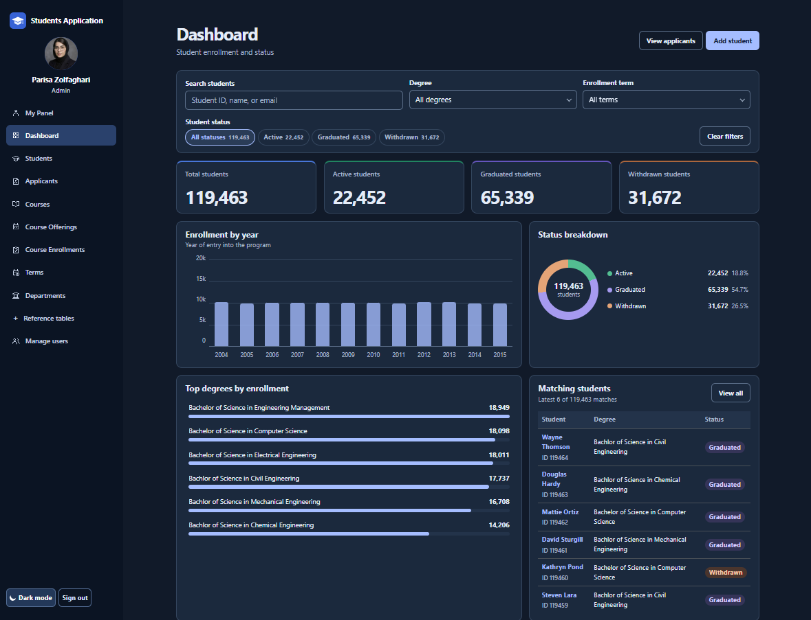
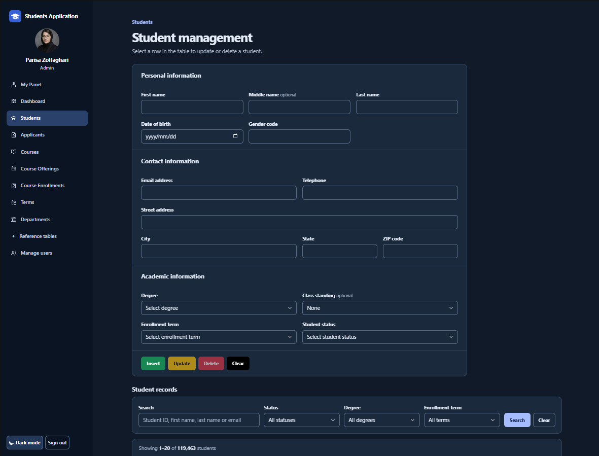
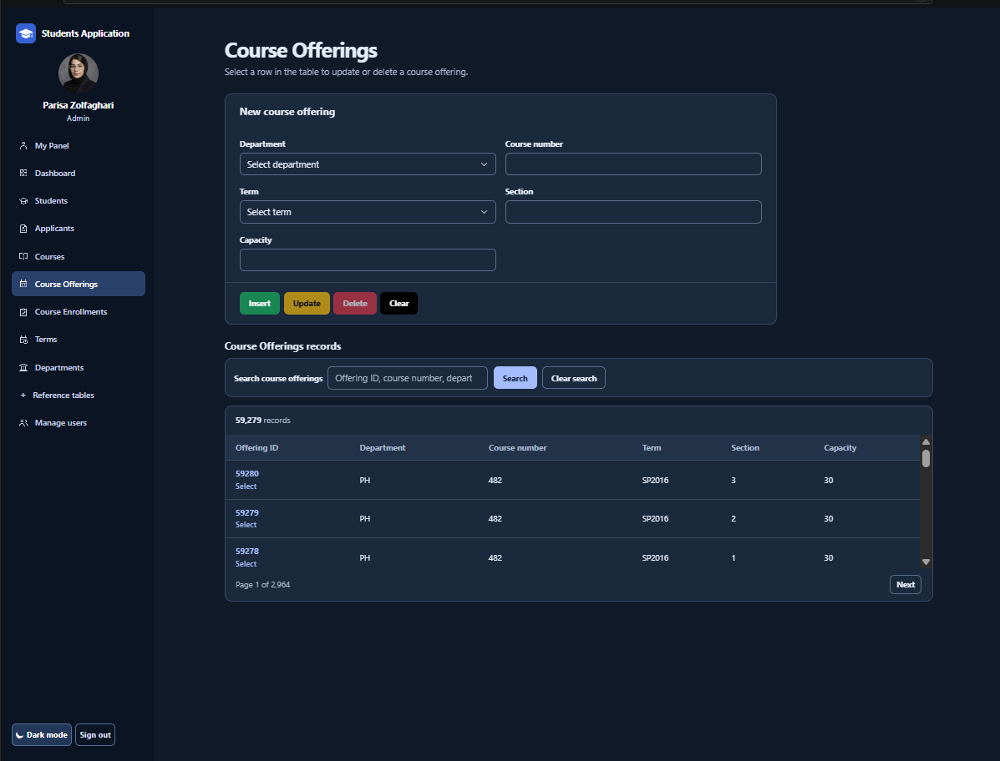
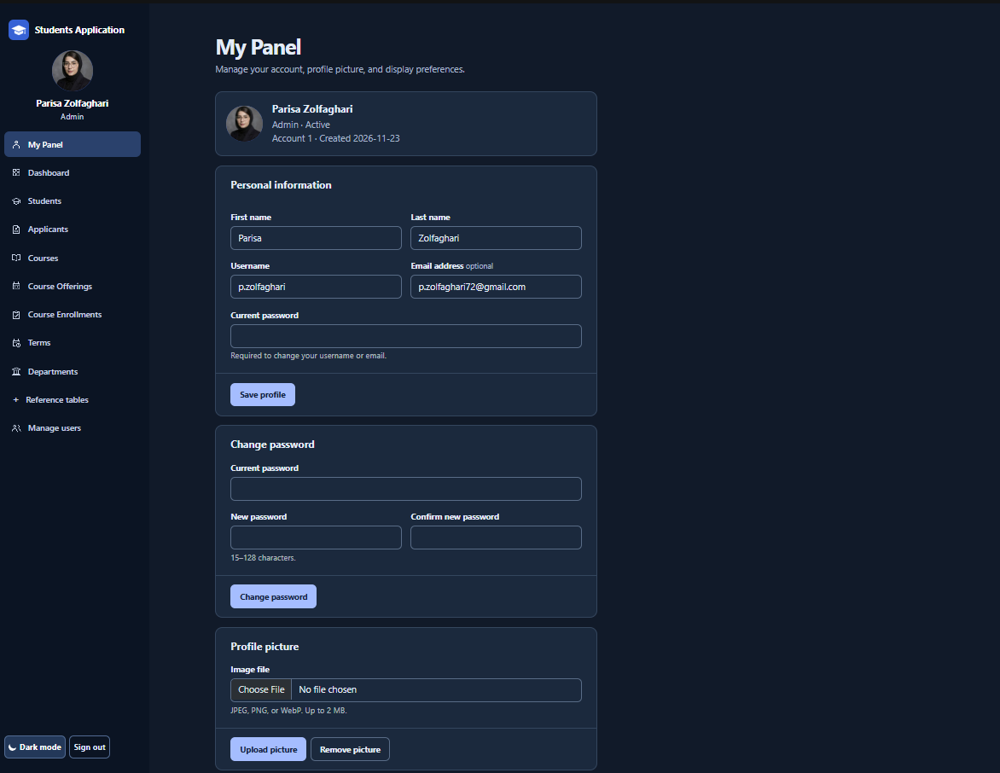

# Students Application

A local FastAPI application for the existing `Students` SQL Server database. The application opens at sign-in. All student and reference records come from SQL Server.

- **Dashboard** updates student counts, enrollment charts, and matching records as you search or change the status, degree, or enrollment term filters. Each slicer shows how many students match the other filters.
- **Students** combines a management form and a searchable, paginated table ordered by newest student ID. Administrators can insert, update, or confirm deletion. Clear returns to a blank form.
- **Applicants** provides a searchable, paginated admissions table ordered by applicant ID, with administrator controls to insert, update, and delete records.
- **Courses, Course Offerings, Course Enrollments, Terms, and Departments** have searchable, paginated tables and validated administrator forms. Search Course Enrollments by enrollment, student, or offering ID, or by grade.
- **Reference tables** contains Class Standings, Degrees, Degree Levels, Degree Types, Degree Requirements, Grades, and Sessions. The database enforces existing relationships when a record is deleted.
- **My Panel** provides profile details, a picture, password changes, and browser display preferences.
- **Manage users** lets administrators create accounts, reset passwords, assign roles, and activate or deactivate accounts. An administrator's own role and account status are protected.

## Screenshots

These screenshots show the app populated with sample records.

### Dashboard



### Student management



### Course offerings



### My Panel



## Application roles

| Role | Access |
| --- | --- |
| Admin | View and manage students, applicants, reference records, and application accounts, and edit their profile |
| User | View dashboard, students, applicants, and reference data, and edit their own profile |

Application accounts are stored in `dbo.Users`. Passwords use Argon2id hashing. Each account has one active session at a time. Signing in again, signing out, or changing the password revokes the previous session.

## Install on Ubuntu 24.04 in WSL

Run the following from the project directory.

```bash
sudo apt update
sudo apt install -y python3.12 python3.12-venv unixodbc
python3.12 -m venv .venv
.venv/bin/python -m pip install -r requirements.txt
cp -n .env.example .env
chmod 600 .env
```

Microsoft ODBC Driver 18 is required in WSL. Run `odbcinst -q -d` to check for it. [Microsoft's Ubuntu installation instructions](https://learn.microsoft.com/en-us/sql/connect/odbc/linux/installing-the-microsoft-odbc-driver-for-sql-server-on-linux).

## Configure

Edit `.env` with the following values. Existing environment variables take precedence.

| Variable | Value |
| --- | --- |
| `DB_HOST` | SQL Server hostname or IP address reachable from WSL |
| `DB_PORT` | SQL Server TCP port |
| `DB_NAME` | `Students` |
| `DB_USER` | SQL Server login |
| `DB_PASSWORD` | Password for that login |
| `DB_ODBC_DRIVER` | `ODBC Driver 18 for SQL Server` |

The application's SQL login needs SELECT, INSERT, UPDATE, and DELETE on the managed dbo tables listed above. It also needs SELECT, INSERT, and UPDATE on `dbo.Users`. Optional TLS settings are `DB_ENCRYPT` and `DB_TRUST_SERVER_CERTIFICATE`, which default to `yes` and `no` respectively.

## Run

Run the account-table setup once with a SQL login that can create a table in `dbo`. The command checks for `dbo.Users` and creates it only when missing.

```bash
.venv/bin/python -m app.setup_users
.venv/bin/python -m uvicorn app.main:app --host 127.0.0.1 --port 8000 --no-access-log
```

Open the app from Windows and create the first administrator when prompted. Subsequent visits use the sign-in form. [http://localhost:8000](http://localhost:8000)

The app is intended for local access and serves its bundled Bootstrap 5 stylesheet locally. [Microsoft's WSL networking guide](https://learn.microsoft.com/en-us/windows/wsl/networking).

## Project structure

```text
app/
  main.py       Application setup and error handlers
  routes/       Authentication, profile, accounts, students, and reference records
  auth.py       Account sessions and role checks
  setup_users.py One-time dbo.Users setup
  web.py        Shared templates and form handling
  database.py   Environment configuration and SQL Server sessions
  models.py     Mappings for the existing SQL Server tables
  schemas.py    Input validation
  crud.py       Student and lookup queries
  reference.py  Managed table and form definitions
  analytics.py  Dashboard counts
  preferences.py Browser preference settings
  templates/    Jinja2 layout and student views
  static/       Application CSS
docs/screenshots/ App screenshots with sample data
.env.example
.gitignore
requirements.txt
README.md
```
